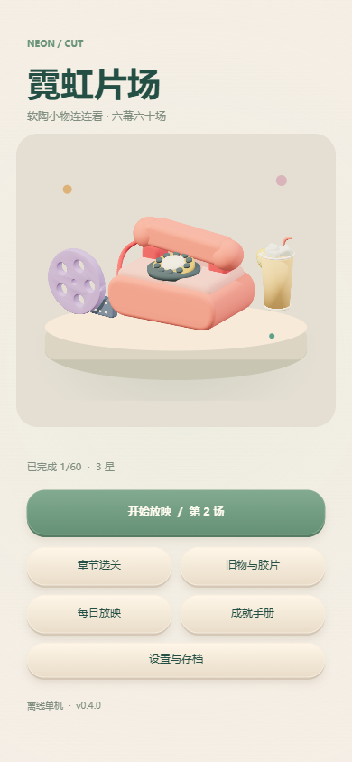

# 霓虹片场 · Neon / Cut

港风旧物主题的连连看单机游戏。Android 测试版 v0.4.1，兼容浏览器与微信小游戏入口。暖奶油色界面、12 件原创哑光软陶道具、手捏轮廓与挤压回弹动画；3D 素材预渲染为图集，降低手机运行负担。

## 公开试玩

[在线游玩](https://wittlud7.github.io/neon-cut-clay/) · [Android 测试包](https://github.com/wittlud7/neon-cut-clay/releases/tag/v0.4.1) · [反馈问题](https://github.com/wittlud7/neon-cut-clay/issues)

这是持续打磨中的公开测试版，欢迎反馈道具辨识度、操作手感与关卡难度。无需登录。

## 开始

浏览器：在本目录运行 `npm start`，打开 http://127.0.0.1:4197 。首页可继续当前关、选关、进入收藏、成就、每日放映和设置。

Android：通过仓库 Releases 下载，或本地构建 `output/android/neon-cut-0.4.1.apk`。首次需要允许所选安装来源安装应用；Android 8.0+，系统 WebView 需支持现代 JavaScript。原生包本身无需网络。签名、构建、测试与 TapTap 发布准备详见 [RELEASE.md](RELEASE.md)。

微信开发者工具导入此目录即可使用原小游戏入口。游客 AppID 用于本地体验；正式预览与发布需替换自己的 AppID。微信文件导入导出暂不开放，Android 与浏览器支持。

## 内容与规则

- 六幕 60 个独立棋盘，8—30 对，4—12 种道具；章节内部渐进，新幕开场适度回落。
- 两次转弯以内连接相同道具，可绕外围。自动处理死局。
- 连续配对触发霓虹双倍，绕行有加分；每关可倒带两次。
- 每幕有不同镜头任务：不借助提示、连续配对、两拐线路、稳定过关或组合目标。清空即可过关，时间与镜头任务分别影响额外一星，不用三星也能推进。
- 六段原创故事，完成每幕修复一卷胶片并解锁结尾；12 件旧物、10 项成就。
- 每日放映从玩家已解锁的关卡中选定一场，记录该日最佳表现，属于每日重映，不宣称是额外生成的新关卡。
- 断点续玩、本地记录、音乐/音效/动效/振动开关与道具名称辅助。设置可导入导出 JSON 存档，并可确认清除游戏进度。

快捷键：H 提示、R 换位、Z 倒带、空格暂停、Esc 返回。

## 构建与检查

`npm test`：规则、60 关解法与逐关通关、存档往返与损坏拒绝、每日记录、成就、导演目标、微信入口模拟。

`python scripts/make-audio.py`：重新生成原创雨夜电钢琴循环。`npm run build:levels`：固定种子重建关卡。

`python scripts/bootstrap-android.py`：下载并校验官方构建工具。`npm run build:android`：生成签名 APK 并检查签名和 manifest。`npm run package:release`：只打包明确允许的源文件；签名资料、工具下载、临时构建和 QA 存档均不进入源码包。

浏览器检查脚本：`scripts/release-check.js`。截图和验证报告在 `output/`。TapTap 商店文字与隐私说明草案在 `store/`。

## 数据与发布边界

游戏不接入账号、广告、内购和第三方统计。所有游戏进度保存在本机。开发者私钥在 `private/`，不得公开，应单独备份。

当前仍是测试版本，不代表已经上架或审核通过。真实设备兼容性、真人难度体验、商店主体/资质与隐私说明正式托管是发行阶段的独立验收项，详情见 RELEASE.md。
